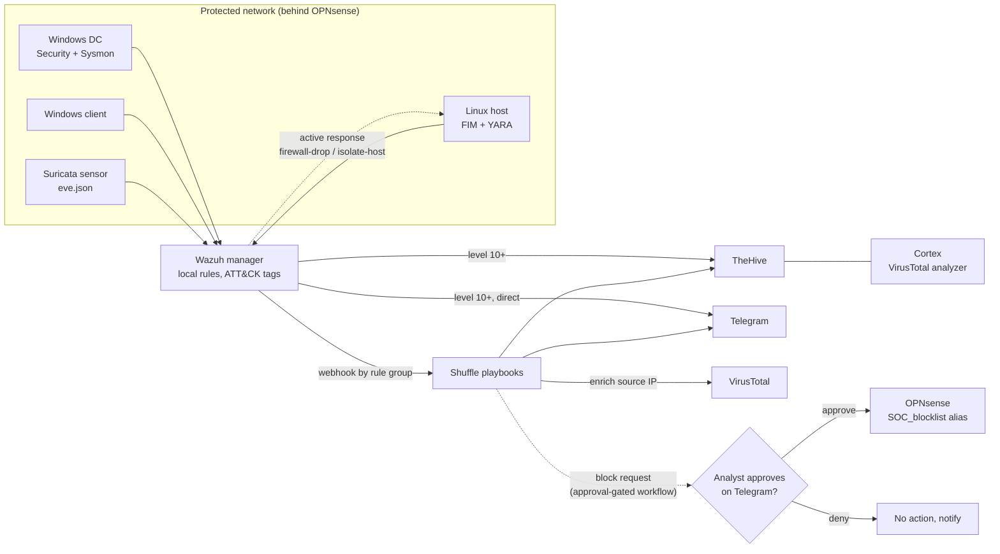

A detection-engineering lab I built during a SOC internship at an insurance company in July 2026. Wazuh collects logs and Suricata alerts from a small Windows and Linux fleet, 17 local rules mapped to 10 MITRE ATT&CK techniques raise the alerts, TheHive opens the cases and Shuffle playbooks respond. In the final setup the playbooks enriched the source IP with VirusTotal and blocked it at the OPNsense firewall automatically; a human-approval gate was built and its routing tested, but it was not in the live path.

It ran on VirtualBox on a single 16 GB workstation, not on the company's network. The company is not named here and nothing in this repository comes from its systems. Only 4 of the 17 rules were proven end to end, so read the notes under the rules table before trusting any row.

It covers Kerberoasting, log clearing, new accounts and privileged-group changes on a domain controller, BadUSB-style keyboards, off-hours logins, SSH brute force followed by a login, malware dropped on a Linux host (YARA), and network attacks seen by Suricata.

## Architecture

Solid lines ran in the lab. Dotted lines are response paths: the two active responses run on the agent without going through Shuffle, and the approval-gated block is a built workflow that was not in the final live path (see below). OPNsense also sends its filter log to Wazuh over syslog.

Versions: Wazuh 4.14.4, TheHive 5.4, Cortex 3.1.7, OPNsense 26.1.6, Shuffle from its upstream images (unpinned), Suricata with the Emerging Threats Open rules.

## Rules

`rules/wazuh/local_rules.xml` holds 17 rules: 16 written for the lab and the stock Wazuh example (100001). Fifteen carry an ATT&CK id, 10 distinct ones. "End-to-end" means a real attack was replayed and checked from alert to notification and action. "Replay" means the logic was fed to `wazuh-logtest`. "Reviewed" means read but never fired. These labels come from the project's notes and I have not upgraded any of them.

| Rule | Level | What it detects | ATT&CK | Validation |
|---|---|---|---|---|
| 100001 | 5 | Stock Wazuh example (sshd failure from a fixed IP), kept as shipped | none | not a detection |
| 100200 | 7 | New file in the watched directory, starts the YARA scan | none | end-to-end |
| 100210 | 12 | YARA match reported by the scan | T1204 | end-to-end |
| 100500 | 10 | Suricata alert in a significant category (web attack, scan, exploit, ...) | T1190 | end-to-end |
| 100501 | 12 | Suricata alert in a critical category (trojan, C2, privilege gain) | T1071 | end-to-end |
| 100502 | 10 | Suricata signature name matches an attack family; catches mis-categorized scans | T1190 | replay |
| 100600 | 10 | Successful Windows logon between 22:00 and 06:00 | T1078 | reviewed |
| 100601 | 10 | Successful SSH login between 22:00 and 06:00 | T1078 | replay |
| 110700 | 10 | New external or USB device on Windows (event 6416) | T1200 | reviewed |
| 110701, 110702 | 13 | New keyboard/HID device on Windows (BadUSB), by class GUID and by class name | T1200 | reviewed |
| 110703 | 10 | New USB device on Linux | T1200 | replay |
| 110800 | 12 | Windows audit log cleared (event 1102) | T1070.001 | reviewed |
| 110810 | 10 | Windows account created (event 4720) | T1136.001 | reviewed |
| 110811 | 12 | Account added to Domain, Enterprise or Schema Admins, local Administrators and similar groups | T1098 | reviewed |
| 110820 | 13 | Successful login after SSH brute force | T1110 | replay |
| 110830 | 12 | Kerberoasting: RC4 service ticket requested for a non-machine service account (event 4769) | T1558.003 | reviewed |

Counts: 4 end-to-end, 4 replay, 8 reviewed (all Windows), 1 stock example. The Windows rules stayed at "reviewed" because `wazuh-logtest` does not run Windows events through the `windows_eventchannel` decoder, so replay cannot reach the built-in rules they depend on (see `validation/README.md`).

## Approval-gated response

An automatic firewall block is riskier than automatic detection: an address shared by many users, or a legitimate proxy, would cut a service for everyone. So `soar/workflows/01_approval_gate_block_ip.json` sends a Telegram message with the suspected IP and reason, and only adds the address to the `SOC_blocklist` alias on OPNsense if someone clicks approve. Details are in `soar/README.md`.

Status: I exercised the gate's routing with test requests, but the recorded test shows the block call failing because the firewall VM was off, and I have no run where it blocked an address. In the final lab setup the perimeter block ran automatically after VirusTotal enrichment, because the gate made the playbooks harder to read. Putting a targeted approval back in front of the block is the first thing I would do for production.

## Deployment

Full steps are in `deploy/README.md`. In order: Wazuh single-node 4.14.4 (`deploy/wazuh/`), TheHive, Cassandra and Cortex (`deploy/thehive-cortex/`), then Shuffle with `deploy/shuffle/install-shuffle.sh`. The Shuffle script enables Docker Swarm, which changes a host network setting and can cut Wazuh off from its indexer; check that `sysctl -n net.bridge.bridge-nf-call-iptables` prints `0` ([post-mortem](docs/postmortem-swarm-netfilter.md)). Then copy `integrations/` into the manager, install the rules, import the workflows, and build the VMs (OPNsense, a Linux victim, a Suricata sensor, a Windows DC with scripts in `deploy/windows-dc/`).

Secrets are not in the files: copy the `.env.example` files and set the variables listed in `deploy/README.md`. This copy has not been redeployed from scratch after anonymization. Other directories: `rules/`, `integrations/` (Telegram and TheHive scripts), `soar/` (scrubbed Shuffle exports), `validation/` (how the rules were tested, with a French runbook).

## Limitations

- Lab only. No false-positive rate was measured, and default credentials were used for several components; change them before anything real.
- Validation evidence is thin: statuses come from my notes, with no screenshots or raw logs. Timings (alert under 10 s, host isolation under 2 s, block about 15 s) are single observations.
- Eight Windows detections, including Kerberoasting and log clearing, have never fired on a real event.
- The YARA wrapper, the `yara_decoder` definition, the `isolate-host` active response and the Suricata configuration were not saved with the project, so the YARA chain cannot be rebuilt from this repository alone.
- A port scan produced more than 10 Telegram messages; there is no deduplication.
- Blind spots: in-memory malware, encrypted traffic, keystroke injection after a BadUSB device is accepted, slow or distributed brute force, machines without an agent.
- Shuffle's runner mounts the Docker socket (root-equivalent), the original lab kept some secrets in clear text in workflow nodes, and approval links are bare webhook URLs with no identity check or expiry. There is no high availability or monitoring of the SOC itself.
- TheHive 5's licence model was not verified, so I do not claim the whole stack is open source. The lab's own files are MIT ([LICENSE](LICENSE)); `deploy/wazuh/docker-compose.yml` is derived from wazuh-docker and keeps its GPLv2 header.
