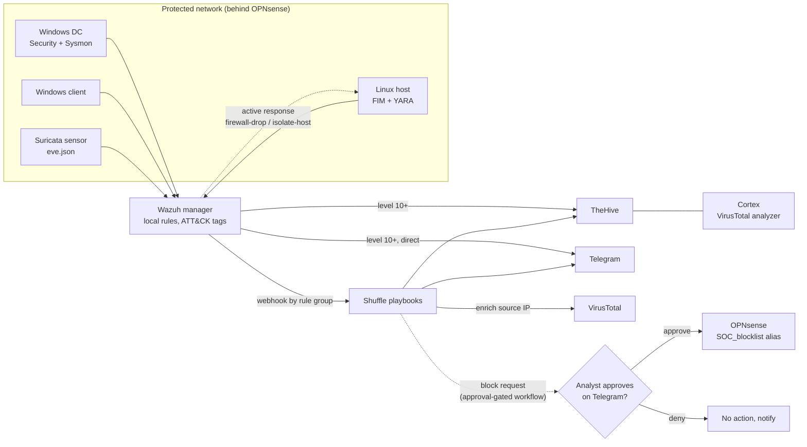

# detection-lab

A detection-engineering lab I built during a SOC internship at an insurance company in July 2026. It collects logs and network alerts from a small Windows and Linux fleet, applies a local ruleset of 17 Wazuh rules mapped to 10 MITRE ATT&CK techniques, opens cases in TheHive, and runs response playbooks in Shuffle. One of those playbooks asks a human before it blocks an IP at the OPNsense firewall.

It ran on VirtualBox on a single 16 GB workstation, not on the company's network. The company is not named here and nothing in this repository comes from its systems.

What it detects: Kerberoasting, log clearing, new accounts and privileged-group changes on a domain controller, BadUSB-style keyboard devices, off-hours logins, SSH brute force followed by a successful login, malware dropped on a Linux host (YARA), and network attacks seen by Suricata.

How: Wazuh agents ship Windows, Linux and Suricata `eve.json` events to a Wazuh manager. Local rules in `rules/wazuh/local_rules.xml` raise levels and tag techniques. Alerts at level 10 or above go to TheHive and Telegram, and to Shuffle where a playbook enriches the source IP and decides what to do.

Read the notes under the rules table before trusting any row: only 4 of the 17 rules were proven end to end.

## Architecture



Solid lines are the paths that ran in the lab. Dotted lines are response paths: the two active responses run on the agent without going through Shuffle, and the approval-gated block is a built workflow whose live status is explained below. OPNsense also sends its filter log to Wazuh over syslog.

Versions: Wazuh 4.14.4, TheHive 5.4, Cortex 3.1.7, OPNsense 26.1.6, Shuffle from its upstream images (unpinned), Suricata with the Emerging Threats Open rules.

## Rules

`rules/wazuh/local_rules.xml` holds 17 rules: 16 written for the lab and the stock Wazuh example rule (100001). Fifteen carry an ATT&CK id, 10 distinct ones; the example and 100200 (which only starts a YARA scan) do not.

"end-to-end" means a real attack was replayed and checked from alert to notification and action. "replay" means the logic was fed to `wazuh-logtest`. "reviewed" means read but never fired. These labels are from the project's own notes and I have not upgraded any of them.

| Rule | Level | What it detects | ATT&CK | Validation |
|---|---|---|---|---|
| 100001 | 5 | Stock Wazuh example (sshd failure from a fixed IP), kept as shipped | none | not a detection |
| 100200 | 7 | New file in the watched directory, starts the YARA scan | none | end-to-end |
| 100210 | 12 | YARA match reported by the scan | T1204 | end-to-end |
| 100500 | 10 | Suricata alert in a significant category (web attack, scan, exploit, ...) | T1190 | end-to-end |
| 100501 | 12 | Suricata alert in a critical category (trojan, C2, privilege gain) | T1071 | end-to-end |
| 100502 | 10 | Suricata signature name matches an attack family; catches mis-categorized scans | T1190 | replay |
| 100600 | 10 | Successful Windows logon between 22:00 and 06:00 | T1078 | reviewed |
| 100601 | 10 | Successful SSH login between 22:00 and 06:00 | T1078 | replay |
| 110700 | 10 | New external or USB device on Windows (event 6416) | T1200 | reviewed |
| 110701 | 13 | New keyboard/HID device on Windows, by class GUID (BadUSB) | T1200 | reviewed |
| 110702 | 13 | Same, by class name, as a safety net | T1200 | reviewed |
| 110703 | 10 | New USB device on Linux | T1200 | replay |
| 110800 | 12 | Windows audit log cleared (event 1102) | T1070.001 | reviewed |
| 110810 | 10 | Windows account created (event 4720) | T1136.001 | reviewed |
| 110811 | 12 | Account added to Domain, Enterprise or Schema Admins, local Administrators and similar groups | T1098 | reviewed |
| 110820 | 13 | Successful login after SSH brute force | T1110 | replay |
| 110830 | 12 | Kerberoasting: RC4 service ticket requested for a non-machine service account (event 4769) | T1558.003 | reviewed |

Counts: 4 end-to-end, 4 replay, 8 reviewed (all Windows), 1 stock example.

The Windows rules stayed at "reviewed" for a tooling reason: `wazuh-logtest` does not run Windows events through the `windows_eventchannel` decoder, so replay cannot reach the built-in rules they depend on. Details in `validation/README.md`.

## Approval-gated response

The idea: automatic detection and enrichment are cheap to get wrong in a harmless way; an automatic firewall block is not. An address shared by many users, or a legitimate proxy, would cut a service for everyone. So the block waits for a person.

The workflow in `soar/workflows/01_approval_gate_block_ip.json` has one webhook and three outcomes. A `request` sends a Telegram message with the suspected IP, the reason and two links. Clicking approve calls the OPNsense API to add the address to the `SOC_blocklist` alias; clicking deny sends a no-action notice. Everything is logged in Shuffle. Details and limits are in `soar/README.md`.

Status, stated plainly. I built the gate and exercised its routing with test requests, but the recorded test shows the final block call failing because the firewall VM was off, and I have no run where it blocked an address. In the final lab setup the perimeter block ran automatically after VirusTotal enrichment, and I had removed the gate from the live path because it made the playbooks harder to read than the straight-line ones. Putting a targeted approval back in front of the block is the first thing I would do for production.

## Deployment

Short version, full steps in `deploy/README.md`:

1. Wazuh single-node (4.14.4) from the upstream wazuh-docker project, using the compose file and manager additions in `deploy/wazuh/`.
2. TheHive, Cassandra and Cortex from `deploy/thehive-cortex/`.
3. Shuffle last, with `deploy/shuffle/install-shuffle.sh`. It enables Docker Swarm, which changes a host network setting and can cut Wazuh off from its indexer. Check `sysctl -n net.bridge.bridge-nf-call-iptables` prints `0`. The story is in `docs/postmortem-swarm-netfilter.md`.
4. Copy `integrations/` into the manager, install the rules, import or build the workflows.
5. VMs: OPNsense, a Linux victim, a Suricata sensor, a Windows domain controller (scripts in `deploy/windows-dc/`).

Secrets are never in the files. Copy the `.env.example` files, set the variables listed in `deploy/README.md`, and keep them out of Git. This copy has not been redeployed from scratch after anonymization.

## Repository layout

```
rules/        Wazuh rules, plus notes on Suricata, YARA and Sysmon
integrations/ Wazuh to Telegram and Wazuh to TheHive scripts
soar/         Shuffle workflow exports (scrubbed) and the scripts that build them
deploy/       Compose files, install scripts, Windows PowerShell, OPNsense script
validation/   How the rules were tested, status per rule, manual runbook (French)
docs/         Post-mortem of the Swarm and netfilter incident
```

## Limitations

- Lab only. Nothing here ran on the insurance company's systems, and no false-positive rate was measured.
- Validation evidence is thin. The statuses above come from my notes; screenshots and raw logs are not included. Timings (alert in under 10 s, host isolation under 2 s, block in about 15 s) are single observations without a timestamp series.
- Eight Windows detections, including Kerberoasting and log clearing, have never fired on a real event.
- Missing files: the YARA wrapper, the `yara_decoder` definition, the `isolate-host` active response and the Suricata configuration were not saved with the project, so the YARA chain cannot be rebuilt from this repository alone. See `rules/`.
- A noisy attack (a port scan) produced more than 10 Telegram messages. There is no deduplication.
- Detection blind spots: in-memory malware, encrypted traffic, keystroke injection after a BadUSB device is accepted (only the plug-in is detected), slow or distributed brute force, and machines without an agent.
- Shuffle's runner mounts the Docker socket, which is root-equivalent on the host, and the original lab kept some secrets in clear text in workflow nodes. No high availability and no monitoring of the SOC itself: if the host dies, detection stops silently.
- Approval links in the gate are bare webhook URLs with no identity check or expiry.
- TheHive 5's licence model was not verified, so I do not claim the whole stack is open source.
- Default credentials were used in the lab for several components and must be changed before anything real.

No license is included yet.
